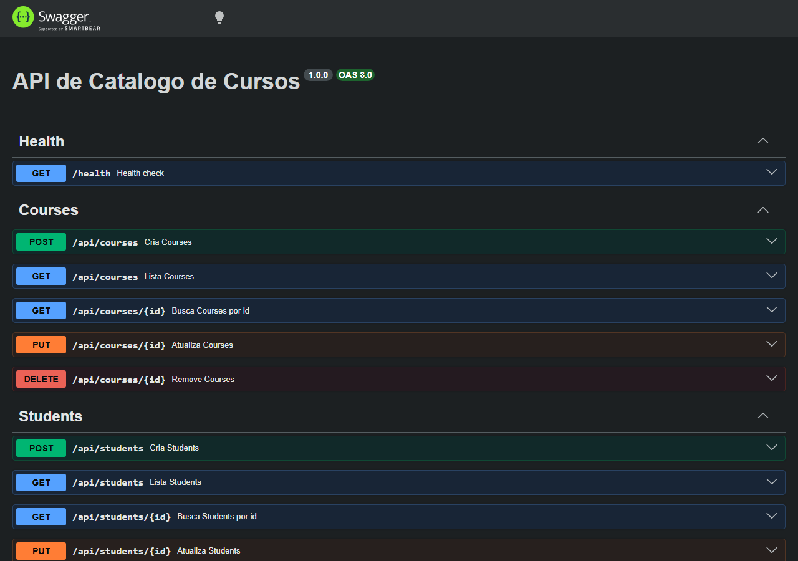

# Cursos API: Express vs NestJS

API REST de catálogo de cursos com cursos, estudantes e matrículas, implementada em duas versões (Express e NestJS) com o mesmo domínio e requisitos.




Mesma API REST implementada duas vezes, para comparar uma estrutura livre com uma guiada por convenções:

| Pasta | Stack | Porta (local) |
| --- | --- | --- |
| [`express-api`](express-api) | Express 5, TypeScript, Prisma, Zod, Jest + supertest | 3000 |
| [`nest-api`](nest-api) | NestJS, TypeScript, TypeORM, class-validator, Vitest + supertest | 3001 |

Dominio: `Course`, `Student` e `Enrollment` (matricula), com relacionamento N:N entre estudante e curso. A matricula e unica por (`studentId`, `courseId`).

Banco: SQLite em desenvolvimento e testes (sem instalar nada), PostgreSQL no Docker.

## Rodar localmente

Requer Node 22+.

### Express

```bash
cd express-api
npm install
cp .env.example .env
npx prisma migrate deploy
npm run db:seed        # opcional: 3 cursos e 2 estudantes
npm run dev
```

### NestJS

```bash
cd nest-api
npm install
cp .env.example .env
npm run start:dev      # as migrations rodam sozinhas no bootstrap
npm run db:seed        # opcional
```

Em ambas: `GET /health` responde `{ "status": "ok" }` e a documentacao Swagger fica em `/docs`.
O `.env` define `PORT` e `DATABASE_URL` (veja `.env.example`).

## Testes

```bash
cd express-api && npm test   # Jest + supertest, SQLite isolado (prisma/test.db), migrations aplicadas antes
cd nest-api && npm test      # Vitest + @nestjs/testing + supertest, SQLite em memoria, migrations no bootstrap
```

Cobrem: `POST /courses` valido e invalido, email de estudante duplicado (409), matricula repetida (409), curso inexistente (404), ids invalidos, paginacao e cascade.

## Docker

Cada projeto tem `Dockerfile` e `docker-compose.yml` com PostgreSQL + API.

```bash
cd express-api && docker compose up --build   # http://localhost:3000
cd nest-api && docker compose up --build      # http://localhost:3001
```

Detalhe do Express: o Prisma fixa o provider no schema, entao existem dois arquivos, `prisma/schema.prisma` (SQLite, usado em dev/teste, com migrations) e `prisma/schema.postgres.prisma` (usado no container, que aplica o schema com `prisma db push`). Mantenha os dois em sincronia. No Nest as mesmas migrations rodam nos dois bancos.

## Endpoints (prefixo `/api`)

| Metodo | Rota | Sucesso | Observacao |
| --- | --- | --- | --- |
| POST | `/courses` | 201 | `title` com no minimo 3 caracteres |
| GET | `/courses` | 200 | filtro `?category=`, paginacao `?page=&limit=` (total em `X-Total-Count`) |
| GET | `/courses/:id` | 200 | 404 se nao existir |
| PUT | `/courses/:id` | 200 | 404 se nao existir |
| DELETE | `/courses/:id` | 204 | 404 se nao existir |
| POST | `/students` | 201 | `email` valido e unico (409 se duplicado) |
| GET | `/students` | 200 | paginacao opcional |
| GET | `/students/:id` | 200 | 404 se nao existir |
| PUT | `/students/:id` | 200 | 409 se o email for de outro estudante |
| DELETE | `/students/:id` | 204 | remove as matriculas dele |
| POST | `/enrollments` | 201 | body `{ studentId, courseId }`; 409 se repetida, 404 se id inexistente |
| GET | `/students/:id/enrollments` | 200 | matriculas com o curso |
| DELETE | `/enrollments/:id` | 204 | cancela a matricula |

Exemplos (troque a porta para 3001 no Nest):

```bash
curl -X POST localhost:3000/api/courses -H "Content-Type: application/json" \
  -d '{"title":"Node.js do zero","category":"backend"}'

curl -X POST localhost:3000/api/students -H "Content-Type: application/json" \
  -d '{"name":"Ana Souza","email":"ana@example.com"}'

curl -X POST localhost:3000/api/enrollments -H "Content-Type: application/json" \
  -d '{"studentId":1,"courseId":1}'

curl localhost:3000/api/students/1/enrollments
curl "localhost:3000/api/courses?category=backend&page=1&limit=10"
```

## Erros

Formato unico nas duas APIs:

```json
{
  "message": "Curso nao encontrado",
  "details": [],
  "path": "/api/courses/999",
  "timestamp": "2026-11-13T14:00:00.000Z"
}
```

`details` so aparece em erros de validacao.

| Status | Quando | Exemplo de `message` |
| --- | --- | --- |
| 400 | JSON malformado (Express) | `JSON malformado` |
| 404 | recurso ou rota inexistente | `Curso nao encontrado` |
| 409 | email duplicado, matricula duplicada | `email ja cadastrado` |
| 422 | payload, query ou id invalido | `payload invalido` |
| 500 | falha interna inesperada | `erro interno do servidor` |

No Express o `errorHandler` unico decide status e corpo (inclusive `ZodError` e `AppError`). No Nest, o `AllExceptionsFilter` global faz o mesmo para `HttpException` e erros desconhecidos, e o `ValidationPipe` usa 422.

## Estrutura

### Express (`express-api/src`)

```
routes/        define os caminhos e liga ao controller
controllers/   le/valida request (zod) e responde
services/      regras de negocio, traduz erros do banco (P2002 -> 409, P2025 -> 404)
repositories/  unico ponto de acesso ao Prisma
schemas/       schemas zod
middlewares/   errorHandler, notFoundHandler
docs/          OpenAPI servido pelo swagger-ui-express em /docs
```

Fluxo: `routes -> controllers -> services -> repositories -> Prisma`.

### NestJS (`nest-api/src`)

```
courses/ students/ enrollments/   um modulo por dominio: Module, Controller, Service, Repository, entity, dto/
common/                           AllExceptionsFilter, paginacao, deteccao de violacao de unicidade
database/                         config do TypeORM (SQLite ou Postgres por DATABASE_URL), migrations, seed
app.setup.ts                      prefixo /api, CORS, ValidationPipe global, filtro, Swagger (compartilhado com os testes)
```

`ValidationPipe` global com `whitelist`, `forbidNonWhitelisted` e `transform`, retornando 422.

## Licenca

MIT, veja [LICENSE](LICENSE).
